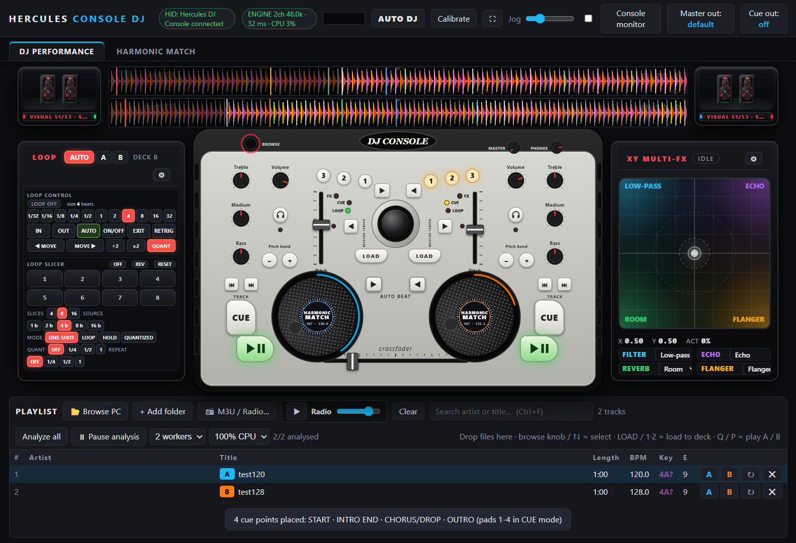
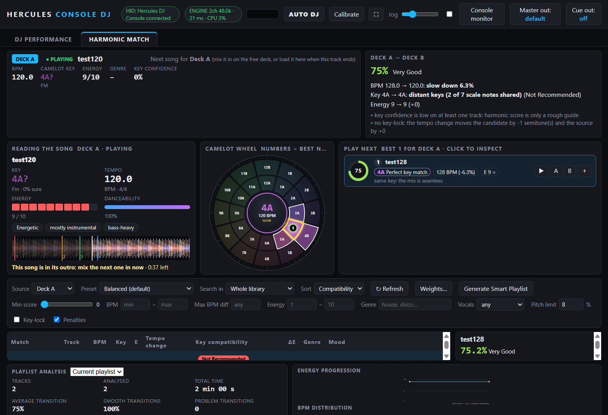
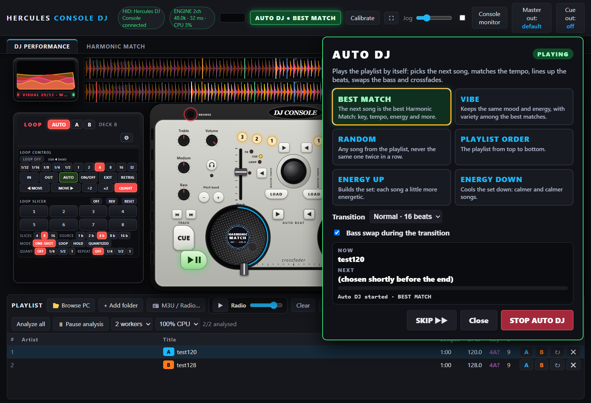
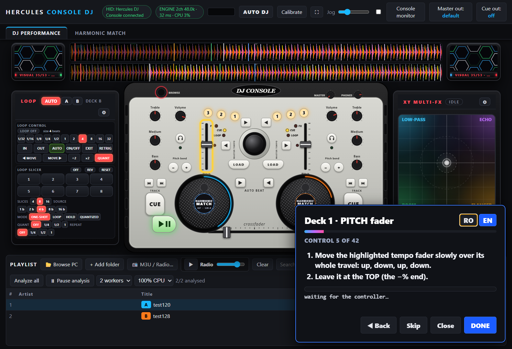

# Hercules Console DJ


**Free two-deck DJ software drawn after, and built for, the original Hercules DJ Console (Windows Edition, USB `06F8:B000`).** Plug the console in and the screen becomes the console: knobs, pitch faders, jog pads, pad buttons, joystick and crossfader move with the real ones, and the lights of the console follow the decks.

This is a sibling of [Party Mix DJ](https://github.com/unupunct/Party-Mix-DJ): the same audio engine, library and effects, with a new faceplate and a new controller layer. It is an independent project, not affiliated with or endorsed by Hercules / Guillemot.



## How the console is read
The original DJ Console is a **HID joystick**, not a MIDI device: the controls arrive as one 19-byte input report (30 buttons, 15 axes) and the lamps are written with a 3-byte output report. The app opens it through WebHID, so no extra driver is needed for the controls (Windows shows it as a game controller; the sound card part uses Hercules' own audio driver).

| Control | Where it is read |
|---|---|
| Buttons (play, cue, auto beat, track back / forward, load, pitch bend - / +, master tempo, layer, pads 1-3, monitor) | 30 bits |
| TREBLE / MEDIUM / BASS per deck, crossfader | pots |
| Pitch faders, volume knobs | pots |
| Jog pads | endless encoders |
| Joystick (left / right = the DJ filter) | two axes (at rest 128 / 128) |

The decoding was read from the descriptor of a real unit and cross-checked against the community Mixxx mapping. Because the console only reports positions, a **calibration wizard** learns every control from your own unit (see below).

## Features
- **The console on screen**: silver plate, black body, DJ CONSOLE badge, studded jog pads with the **HARMONIC MATCH** hub in the centre (press it to find the next song for that deck), pad buttons **3 2 1** with the **FX / CUE / LOOP** lights, vertical **pitch faders**, **joystick filter** (springs back to the centre), crossfader. The face is scaled to the window and is also fully usable with the mouse.
- **Two decks**: colour waveforms you control with the mouse (click, drag, wheel), beat-grid sync (also half / double time), hot cues with **automatic cue points** after analysis, pitch bend, scratch mode, loops from 1/32 to 32 beats.
- **Native Rust audio engine** (WASAPI on Windows, CoreAudio on macOS): per-deck 3-band EQ, a master DJ filter (low-pass / high-pass, 24 dB per octave), a limiter, headphone cue on channels 3/4 of the console's sound card or on a second device, and a Web Audio fallback.
- **Loop Control and Loop Slicer**, **XY Multi-FX pad** (28 effects) and **36 pad effects**.
- **Harmonic Match** and **Auto DJ**: a background analyser builds a local library of BPM, beat grid, key and energy; the best next songs are plotted on a Camelot wheel with a 0-100 compatibility score; Auto DJ plays the playlist by itself (best match, vibe, random, playlist order, energy up / down) with beat-matched, bass-swapped transitions.
- **Visuals** beside the waveforms (50 presets plus speaker models), a PC **folder browser**, **M3U / PLS playlists and internet radio**.

| | |
|---|---|
|  |  |
| Harmonic Match: key, tempo, energy, the Camelot wheel and the best next song | Auto DJ with six selection modes |

## Calibration
On the first start (and any time from the **Calibrate** button or **Audio settings**) a wizard walks through the **42 controls** of the console. Each control is highlighted on the screen; you move or press just that one on the console and the app records which part of the report it is and its real travel. Controls you skip keep the built-in mapping. The wizard speaks English and Romanian.



## Download and install
Get the files from the **[Releases](https://github.com/unupunct/Party-Mix-DJ---Hercules/releases/latest)** page.

| File | What it is |
|---|---|
| `HerculesConsoleDJ-Setup-1.0.0.exe` | Windows installer (per user, no admin rights needed) |
| `HerculesConsoleDJ-1.0.0-portable.exe` | Windows, a single file that runs without installing |
| `HerculesConsoleDJ-1.0.0-mac-arm64.dmg` | macOS, Apple silicon (M1 and later) |
| `HerculesConsoleDJ-1.0.0-mac-x64.dmg` | macOS, Intel |

Windows may show a SmartScreen warning because the app is not code-signed: **More info → Run anyway**. On macOS the app is not signed or notarised: **right-click the app → Open → Open**; if macOS says the app is damaged, run `xattr -cr "/Applications/Hercules Console DJ.app"` once.

Requirements: Windows 10 / 11 (64-bit) or macOS 12 or later, and the Hercules DJ Console for the hardware part (the app also starts without it and works with the mouse).

### Audio
By default the app plays on your Realtek speakers when it finds them, otherwise on the console's sound card. Choose the master output and the headphone cue in **Audio settings**. For the console's own headphone jack pick "Headphone jack of this device (channels 3/4)".

### The joystick also moves the mouse cursor
Windows sees the console's joystick as a mouse as well. If you do not want that, `scripts/console-mouse.ps1` switches that interface off (it asks for administrator rights; `-Enable` switches it back on). The app reads the joystick through a different interface, so it keeps working either way.

## Status and known limits
- **Verified**: 236 automated checks pass (HID decoding, the face layout, the 42-control wizard, the engine, Harmonic Match, Auto DJ, effects) on a real Windows machine with a real console attached. The app connects to the console and the unit accepts the LED report.
- **Not verified by eye / on hardware yet**: which output bit lights which lamp, the direction of the pitch faders (calibration learns it), the buttons whose meaning is only known from the community mapping (the two pairs of LOAD bits are both mapped to LOAD), and the **macOS build with a real console** (WebHID on macOS should need no driver, but it has not been tried).
- The pitch range of the faders is ±8 %.

## Build from source
Needs Node.js 22+ and the Rust toolchain.

```bash
npm install
npm start                # run the app (build the audio engine first: npm run build:engine)
npm run dist             # Windows installer + portable exe
npm run dist:mac         # macOS .dmg files (on a Mac; see .github/workflows/build-mac.yml)
npm run test:engine      # Rust tests
npm run test:js          # JavaScript unit tests
```

The in-app self-test runs with `DJ_SELFTEST=1` (see `electron/selftest.js` and `scripts/verify-all.ps1`).

## Project layout
`electron/` main process and self-test · `public/` the UI (`hercules.js` is the HID layer, `console.js` the face, `calib.js` the wizard) · `engine/` the Rust audio engine and library · `scripts/` tools · `ARCHITECTURE.md`, `DEVELOPMENT_LOG.md`, `HARDWARE_SUPPORT.md` for the details.
